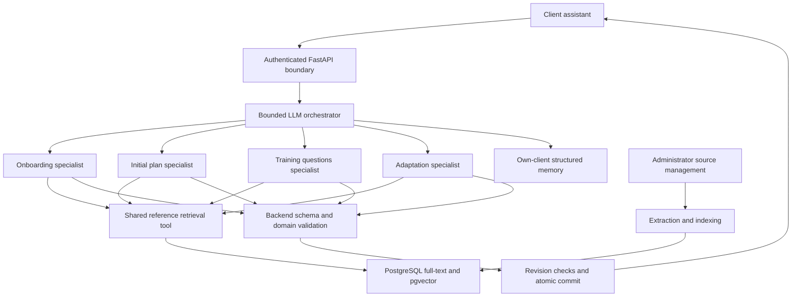

# Local RAG and multiagent assistant design

**Status:** consolidated for final owner confirmation; implementation has not
started. Interview decisions Q1–Q37 are recorded in the
[canonical requirements](requirements.md#rag-and-multiagent-assistant-design--2026-10-19).
This document translates those decisions into proposed contracts and delivery
work; it does not independently override or extend the canonical specification.
Detailed defaults below are reviewable implementation proposals, not completed
features. No requirement is marked verified by this document.

## Outcome and scope

Deliver one client-facing assistant that uses administrator-provided references,
compact client memory, and four specialists coordinated by an LLM orchestrator.
The entire system must work locally without paid APIs after initial provisioning.
Explicitly configured OpenAI services remain optional, separately for generation
and embeddings. No failure may silently enable hosted processing.

Scope: EXT-RF-AI-01, RF-15, RF-18, RF-19; preserve RF-11–RF-13 completion gates,
RF-17 lifecycle, single-draft protection, client isolation, and instructor review.
The approved UI additions are administrator reference management and client
memory controls. No new health schema, medical diagnosis, automatic plan
activation, OCR, web crawler, separate vector database, graph framework, or
offline installer is included. Existing biometric pilot limitations remain.

## Architecture and execution

Agents are software roles inside the existing FastAPI modular monolith. They
share the configured generation adapter and need not load separate copies of a
model. Existing unambiguous deterministic onboarding shortcuts may continue;
LLM routing does not replace backend authorization or completion checks.

Proposed request sequence:

1. Resolve Account/Client from authenticated identity; enforce role and request
   idempotency. Load permitted state and revision identifiers. Start one total
   deadline before provider work.
2. Assemble bounded own-client context. Keep authoritative facts, reported
   memories, source passages, and instructions distinct. Supply required
   restrictions without depending on similarity ranking.
3. Ask the orchestrator for a schema-constrained route over allowed specialists
   and any clarification needed. Backend state constrains permissible actions.
4. Invoke only needed specialists and reference searches within the shared
   budgets. Specialists cannot recursively delegate or call arbitrary endpoints.
5. Validate structured results, memory proposals, and citation identities.
   Synthesize through the orchestrator only when necessary; each extra model call
   consumes the same budget. A provider result never proves persistence.
6. Recheck Client/memory/onboarding/plan revisions and reference activation.
   Commit the reply and validated authorized changes atomically. On conflict,
   preserve newer state and return a controlled retryable result.

Provider work must not be given authority to write the database. Ordinary plan
and onboarding domain services continue to own changes and review transitions.
Preserve existing request replay behavior and original-input retry rules;
explicitly test any extraction of those services needed to support atomicity.

## Specialist and tool contracts

| Role | Permitted inputs | Proposed output and backend boundary |
| --- | --- | --- |
| Orchestrator | Permitted current request, workflow state, minimized own-client context | Allowed route, targeted clarification, optional synthesis; cannot approve plans or override gates |
| Onboarding | Current client statement, bounded own interview state, permitted references | Existing grounded answer proposals and clarification; backend verifies evidence and schema, and explicit completion remains required |
| Initial plan | Completed authoritative onboarding, permitted memory, active equipment and references | Structured proposal through the RF-15 service; reuse an existing sole draft; instructor approval remains mandatory |
| Training questions | Own current plan/draft, relevant onboarding, memory, bounded conversation and references | pt-BR reply, citations, non-binding adaptation suggestion; an explicitly requested draft edit uses the existing validated replacement contract |
| Adaptation | Explicitly confirmed request, current/base plan, permitted client context and equipment | Structured operations and explanation; preserve client acceptance and instructor review, stale-base rejection, and immutable history |

Proposed shared contracts:

- **Generation adapter:** validated routing/specialist/synthesis envelopes,
  controlled error categories, usage, and remaining deadline. Retain existing
  provider-specific behavior behind this boundary.
- **Embedding adapter:** embed document/query input with explicit purpose,
  provider/model configuration, dimension checks, and controlled failure. Input
  must fit the model limit; do not silently truncate. No private-memory indexing.
- **Reference retrieval:** minimized query and bounded result limit in; active
  source/version/passage identifiers, title, location, and supporting text out.
- **Memory access:** backend supplies only facts owned by the resolved Client.
  Mutation proposals name the source event and expected revision. The backend
  validates evidence before applying them.
- **Domain actions:** allowlisted typed requests into existing services, never
  arbitrary SQL, shell commands, or model-supplied client identity. Tool access
  is enforced in code, including when retrieved text contains instructions.

Exact Python class names and endpoint paths can follow existing conventions at
implementation time; the authorization and behavior boundaries above remain.

## Reference lifecycle and retrieval

An administrator supplies PDF, Markdown, or plain text from trusted sources.
Track source identity, immutable version identity, title, import status, and
extraction/indexing configuration. Use pypdf for text PDFs; unsupported, empty,
or failed extraction never activates a source. Preview extracted text before
explicit activation. PDF page locations and text-section locations support
citations; extraction must not imply faithful table/reading-order recovery.

Proposed import states are pending, processing, ready, failed, active, and
withdrawn, with replacement selecting a completed ready version atomically.
Persist progress/failure state so process restarts permit a deliberate retry.
Use bounded background execution within the existing backend architecture;
no new broker is approved. Enforce upload, page, extracted-text, and execution
limits before unbounded parser/indexing work. A failed replacement leaves the
old version active unless an administrator explicitly withdraws it.

Use PostgreSQL lexical retrieval and pgvector similarity over shared references.
Proposed pilot implementation: exact vector search and reciprocal-rank fusion,
compared against lexical-only retrieval. Passage boundaries must retain context
and negation and fit the selected embedding model's token limit and retrieval
prefixes. Tune chunking and candidate limits against the fixed evaluation set;
do not treat these tuning values as already benchmarked.

Version embedding provider, model/artifact, dimensions, and preprocessing. Local
EmbeddingGemma uses its documented default 768 dimensions; hosted
`text-embedding-3-small` uses 1,536. Different embedding spaces are never mixed.
Build a compatible replacement index before switching retrieval configuration.
Keep query embeddings ephemeral and out of diagnostic logs. When embeddings
fail, lexical retrieval is allowed; missing evidence produces an honest
limitation/clarification or instructor referral.

Citations refer only to retrieved supporting passages and identify source title,
version, and page/section. Backend checks establish identity and active status;
human evaluation must also assess whether the passage supports the claim.
Ordinary conversation and explanations of saved plans need no document citation.
Withdrawn sources cannot support new answers; retained chat still follows its
existing history/expiration rules.

## Durable client memory

Store current facts, not an accumulating transcript. Proposed fields are Client
owner, opaque fact identity, category, compact normalized statement, reported/
updated dates, attribution, originating event identifier, and revision. Categories
are health reports, preferences, and training goals. Source identifiers must
survive raw-message cleanup without retaining the message itself.

Clear first-person reports and explicit corrections may produce memory proposals;
uncertainty produces clarification. Validate against current source evidence
while it exists. Prior context may clarify the current statement, but must not
alone recreate a forgotten fact. Do not treat an assistant suggestion as a client
fact or silently promote memory into authoritative onboarding. Retain dated
health reports and reconfirm potentially stale information when consequential.

The client can inspect, correct, or forget facts in conversation and in
"Memória do assistente". Direct edits work without AI availability. Revision
guards invalidate earlier in-flight writes. Proposed forgetting implementation:
retain only minimal non-content event/revision suppression needed to prevent
stale replay, with no copy of the forgotten statement. New explicit reports can
create new memory; old context cannot. Erase suppression metadata with Client.

Limits are 50 current facts and 8,000 characters in total. Consolidate duplicates
and explicit supersessions without silently discarding health information. If a
safe update cannot fit, ask the client to review memory; never claim it was saved.
Do not seed durable memory from old conversations automatically during rollout.
This last migration default is proposed for confirmation with the design.

Only the owning client and backend operations serving that client can inspect
memory. Source administration grants no memory access. Instructors retain
existing authorized onboarding/plan access. Delete memory and all derivatives
with Client, even if a shared Employee/Account survives. Existing five-day
onboarding and 30-day training chat continue to support reload, retry, evidence,
and pending actions; durable memory survives those transcript windows.

## Local and optional hosted operation

| Concern | Local default | Explicit hosted option |
| --- | --- | --- |
| Generation | Ollama, existing `qwen3:8b` configuration | Existing configurable OpenAI generation adapter |
| Embeddings | Ollama `embeddinggemma` | OpenAI `text-embedding-3-small` |
| Storage/search | Local PostgreSQL, full-text and pgvector | Same application-owned database |
| Credentials | No paid-provider credentials required | Credentials required only for enabled hosted adapters |

Independent adapter configuration permits deliberate mixed setups. Local mode
disables hosted calls, including Ollama cloud features; no automatic failover to
paid processing is allowed. Preserve provider-neutral schemas and errors.
Only reference passages and minimized topic queries enter embeddings; queries
may still contain health topics, so minimize rather than claim anonymity.

After installation and model downloads, required workflows must work with outbound
internet blocked: local Keycloak/Mailpit, locally accessible invitation/recovery
messages, manual addresses without ViaCEP, local image uploads, and cached model
artifacts. An offline installer and external inbox delivery are outside this
offline acceptance scope. Provision CPU operation and optional GPU acceleration;
the current GPU-only Compose profile needs adjustment.

Initial hardware baseline: i9-9900K, approximately 31 GiB RAM, RTX 2070 SUPER with
8 GiB VRAM; host driver access was verified outside the sandbox. Potential laptop:
seventh-generation i7 and RTX 2070, with actual RAM/VRAM and performance pending.
Host `nvidia-smi` success does not verify container passthrough or model speed.
Measure full-stack memory use, cold/warm performance, and intended request bursts.
The established limits must not be silently relaxed to make a benchmark pass.

## Approved budgets

| Limit | Conversation | Plan generation/adaptation |
| --- | --- | --- |
| Total deadline | 30 seconds | 60 seconds |
| Generation calls, including retries | 4 | 6 |
| Reference retrieval rounds | 2 | 2 |
| Aggregate input tokens | 32,000 | 64,000 |
| Aggregate output tokens | 4,000 | 12,000 |

These are ceilings, not expected usage or per-call context allocations. Apply
provider/model context limits too. Each stage receives the remaining deadline;
adapter retry limits cannot extend the request deadline. Budget exhaustion is a
controlled failure, not permission to drop required restrictions. Instrument
operation, route, duration, usage, and controlled outcomes without raw prompts,
responses, memory values, identifying health details, or credentials.

Reference capacity: 100 active documents; uploads at most 20 MiB and 500 PDF
pages; at most two million extracted characters per document. Processing must
also bound memory/CPU time; exact deployment settings need verification before
support claims. Limits are configurable but changes must preserve acceptance.

## Verification and evaluation rubric

Freeze at least 40 primarily pt-BR questions against versioned test references,
with expected supporting passage sets, answerable/unanswerable labels, and
conflict expectations. Include paraphrases and mixed terminology. Proposed rubric:

- **Retrieval:** among answerable questions, at least 90% retrieve an expected
  supporting passage in the first five results. Report the lexical baseline and
  hybrid result on identical cases; do not exclude failed retrieval requests.
- **Grounding:** split generated guidance into substantive externally checkable
  claims. At least 95% must have citations whose retrieved text actually supports
  the claim. Unsupported/contradicted claims and irrelevant citations fail;
  ordinary greetings and descriptions of saved plan state are not reference
  claims. Report abstentions separately so refusing everything cannot look like
  perfect grounding. Use human review against the written expectations, not an
  unverified model score alone.
- **Critical behavior:** all specified isolation, authorization, forgetting,
  retention/erasure, instruction-injection, validation, retry/concurrency,
  instructor-review, and controlled-failure scenarios pass. No percentage
  threshold excuses a critical failure or unsupported diagnosis.
- **Useful completion:** representative positive cases in each workflow produce
  a valid result under the configured deadline; a controlled timeout verifies
  failure handling but does not count as successful local capability.
- **Regression:** run affected provider/onboarding/training/equipment/erasure
  suites plus frontend/API tests for sources, citations, and memory; cover
  PostgreSQL atomicity and concurrent correction/source-withdrawal cases.
- **Offline proof:** with provisioned artifacts, paid credentials removed and
  external network blocked, exercise imports/indexing, onboarding, generation,
  questions, adaptation review, memory CRUD, reload/retry, and erasure. Verify
  no attempted hosted fallback. Measure CPU/GPU profiles and full-stack load.

Automated tests use controlled providers. Actual local inference and optional
hosted quality/performance trials are separate integration evidence, not a live
dependency of the regression suite. Optional hosted adapters still need contract
coverage; unavailable credentials must be reported as unverified live behavior.
Hardware/model compatibility and real evaluation results remain outstanding.

## UI and delivery sequence

Keep `/assistente` as the single client conversation destination; retain separate
onboarding/training persistence. Use the established MUI theme and ClientShell/
AdminShell, pt-BR text, accessible controls, and existing responsive patterns.
Add client memory controls and source citations plus administrator source upload,
preview, status, activation/replacement/withdrawal. Do not expose agent routing or
provider implementation details in ordinary client conversations.

Proposed dependency-ordered delivery:

1. Verify/pin compatible pgvector and pypdf dependencies and local model/runtime
   artifacts. Establish CPU/optional-GPU profiles and independent generation/
   embedding configuration with local defaults and cloud calls disabled.
2. Implement reference storage, bounded import jobs, administrator UI, full-text/
   vector retrieval, embedding-version isolation, citations, and evaluation data.
3. Implement Client-owned memory, extraction validation, direct controls,
   forgetting/revision protection, and shared-account erasure coverage.
4. Add the bounded orchestrator and four specialist contracts through existing
   domain services. Preserve explicit confirmations and transactional request
   semantics; integrate retrieval and memory without bypassing validators.
5. Run regression, rubric, offline, resource, and failure evidence. Enable for a
   test client, then expand deliberately after verification. Disabling
   orchestration leaves memory controls, onboarding, and instructor work usable.

Do not automatically delete data or remove migrations to disable orchestration.
No code, model downloads, database migrations, or deployment changes have been
performed during this design interview. No commit or push is authorized.

## Decision records and pending evidence

- [ADR 0001: orchestration](adr/0001-bounded-ai-orchestration-and-retrieval.md)
- [ADR 0002: durable memory](adr/0002-durable-client-memory.md)
- [ADR 0003: PostgreSQL retrieval](adr/0003-postgresql-reference-retrieval.md)
- [ADR 0004: mandatory local operation](adr/0004-local-operation-and-optional-hosted-ai.md)
- [Primary-source research and hardware observations](ai-rag-technology-research-2026-10-19.md)

The interview has selected the product/architecture direction. Final confirmation
must cover these proposed contracts, rubric, and migration defaults. Exact package
pins, artifact compatibility, safe ingestion resource settings, useful local
latency, and laptop capacity are implementation evidence gates, not passing
results or permission to weaken requirements. If verification reveals an
incompatible requirement, bring that decision back to the owner.
